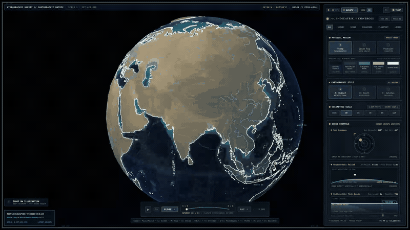
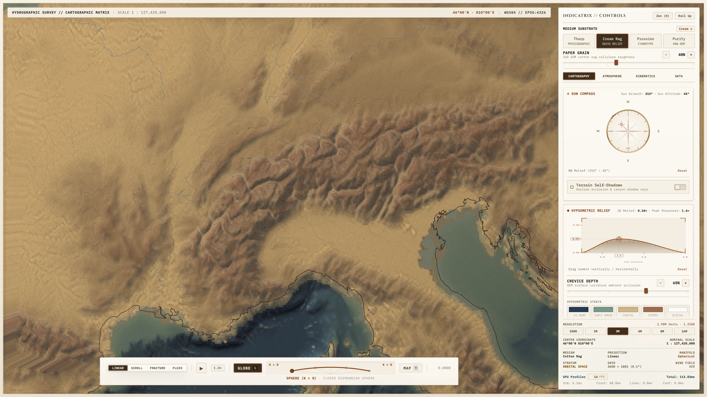
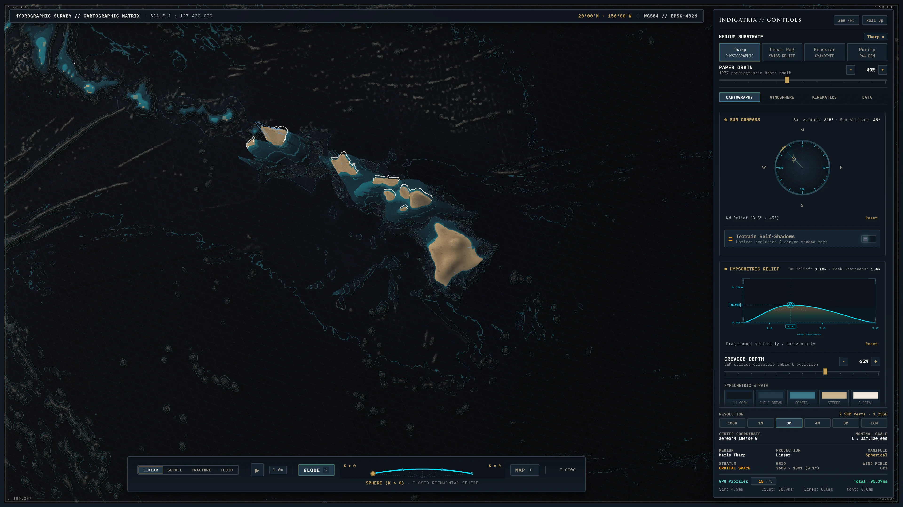
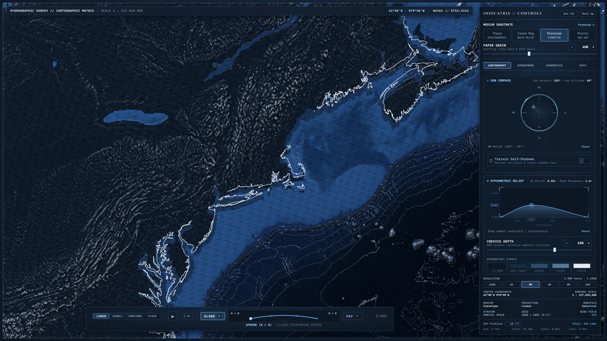
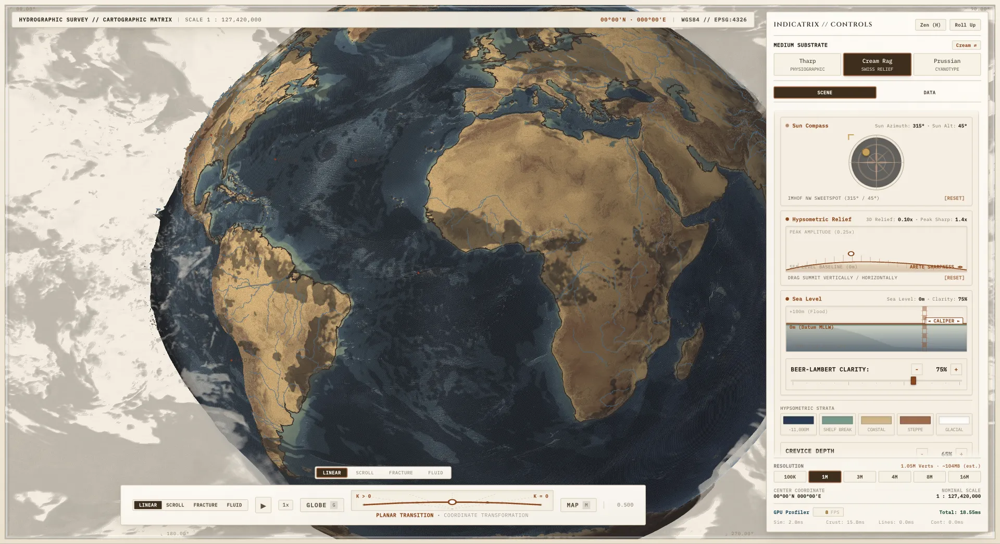

# Indicatrix



An archival cartographic drafting sheet and continuous Riemannian manifold engine built on WebGPU. Morphs seamlessly between a spherical globe ($K > 0$) and planar map projections ($K = 0$) across three historical print mediums, multi-stratum atmospheric fluid dynamics, and live global elevation and weather datasets.






## Quick Start

```bash
git clone https://github.com/AndrewVoirol/indicatrix.git
cd indicatrix
npm install
npm run dev
```

Opens at `http://localhost:3000`. Requires Node.js 20+ and a WebGPU-capable browser (Chrome, Edge, or Safari Technology Preview).

## How It Works

**On the drafting board:** Click and drag to orbit the globe or pan the flat sheet. Scroll to zoom from orbital scale down to regional 10m–30m elevation overlays (Hawaii, Swiss Alps, Grand Canyon, Mount Fuji, Cape Cod). Drag the bottom manifold scrubber or press `Space` to continuously unfurl the sphere into a planar projection (`G` snaps to Globe, `M` snaps to Map). Use the right instrument dock to switch between three physical cartographic mediums (`T`), adjust the NW/SW relief sun compass, dial sea-level datum and Beer-Lambert water clarity, or toggle live wind streamlines, cloud strata, and Doppler precipitation radar. Press `H` for distraction-free Zen mode.

Under the hood, a zero-copy WebGPU compute and multi-pass render pipeline drives dual-surface lithosphere and hydrosphere meshes up to 16,000,000 vertices. Instead of treating Earth as a texture-mapped sphere in dark space, the shader pipeline models physical ink absorption, cellulose paper grain, Eduard Imhof Swiss relief shading, DEM-coupled Laplacian hydrology, and camera-facing screen-space vector ribbons directly in WGSL.

### Three Cartographic Mediums

- **Marie Tharp (1977 Physiographic Panorama)**: Hand-painted ocean floor bathymetry, abyssal stippling, and continental shelf relief inspired by Tharp and Heezen's landmark world ocean chart.
- **Cream Cotton Rag (Swiss Relief)**: 310 GSM warm cotton rag substrate, sepia-charcoal intaglio linework, and classical northwest oblique alpine hillshading.
- **Prussian Cyanotype (1842 Blueprint)**: High-contrast ferroprussiate photochemical exposure with crisp chalk-white vector incisions and bathymetric contours.

### Bring Your Own Planetary & Weather Data

The repository ships with compact baseline elevation, hydrology, and vector assets so it runs immediately on clone. You can pull live meteorological forecasts, orbital ephemeris, or build custom high-resolution binary slices locally using the included CLI pipelines:

```bash
# Pull live NOAA GFS wind & cloud strata, RainViewer Doppler radar, and Starlink TLEs
npm run refresh:planetary

# Stream 0.1° (10km) Google DeepMind WeatherNext 3 Zarr v3 forecast slices (requires Python + uv)
npm run weather:fetch

# Or generate synthetic 24-hour multi-stratum weather slices offline
npm run weather:mock

# Generate higher-density spherical Fibonacci mesh buffers locally (e.g., 1M nodes)
npm run precompute -- --density 1m
```

## Tech Stack

| Layer | Technology |
|---|---|
| Framework | React 19 + TypeScript 7 |
| GPU Compute & Rendering | WebGPU (WGSL compute & multi-pass render pipelines) |
| Fallback Renderer | WebGL 2 custom GLSL shaders + Three.js |
| Cartography & Geometry | D3 Geo, TopoJSON, CDLOD regional DEM streaming |
| Data Ingestion CLI | Node.js (`tsx`) + Python (`uv`, Zarr v3, NetCDF4) |
| Styling & Build | Tailwind CSS 4 + Vite 8 |

## Hardware Note & Disclaimers

This engine was built and tuned uncompromisingly for a personal Apple Silicon workstation (unified memory + Metal WebGPU backend, scaling up to 16M vertices). It is shared **as-is** so others can explore the cartographic pipeline, inspect the shaders, and experiment with their own datasets—without cross-platform hardware guarantees.

All bathymetric soundings, terrain elevations, weather forecasts, and orbital tracks are strictly for **artistic and scientific visualization** and must never be used for marine navigation, aviation, or operational forecasting.

## Data Sources & License

- **Source Code & Shaders**: Licensed for personal, academic, and non-commercial use under the **[PolyForm Noncommercial License 1.0.0](LICENSE.md)**. Commercial use or redistribution requires separate written permission.
- **Planetary & Meteorological Datasets**: Upstream datasets ingested via the CLI pipelines remain governed by their respective providers and licenses, including **GEBCO 2024** (GEBCO Compilation Group), **ETOPO 2022 & CUDEM** (NOAA NCEI), **WeatherNext** (Google DeepMind / Google Research, CC BY 4.0), **NOAA NCEP GFS**, **RainViewer API**, **CelesTrak**, **Natural Earth**, and **WWF HydroSHEDS**. See **[LICENSE.md](LICENSE.md)** for full attributions and terms.

